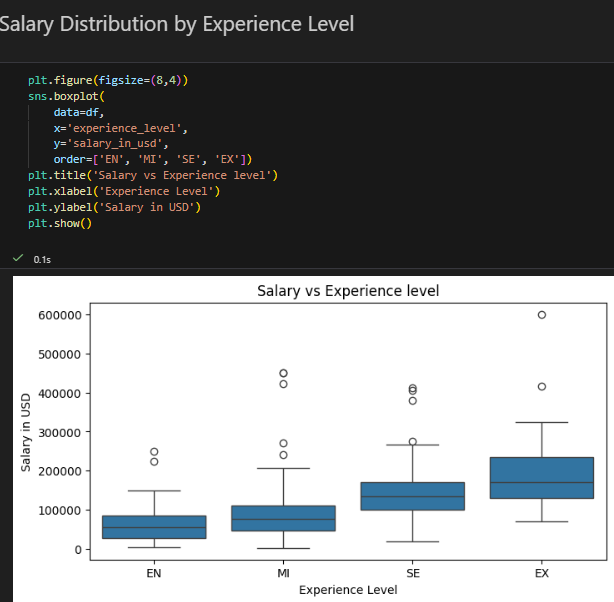

# Data Role Salaries: Compensation Analysis & Prediction

**What drives pay for data roles? A compensation analysis of 607 salary records (2020–2022), with a regression model to estimate salary from role, experience and company profile.**


## Key findings

| Finding | What it means for compensation analysis |
|---|---|
| **Median salary: $101,570**; mean ≈ $112,298 | Pay is right-skewed, so medians are the right headline measure. |
| Median pay rises steadily from entry → mid → senior → executive level | Benchmark within experience levels, not across them. |
| Fully remote roles show a higher median than hybrid or on-site roles | Worth investigating, but role and country mix must be controlled first. |
| Medium and large companies pay more than small companies at the median | Company size is a useful segmentation variable alongside location and role. |



## Business questions

- How does salary vary with experience level?
- How do remote work arrangements and company size relate to pay?
- How accurately can salary be estimated from job and company attributes?

## Approach

1. **Data quality checks:** schema, missing values (none), duplicates (none).
2. **Cleaning:** drop the index column; use `salary_in_usd` as the single-currency target.
3. **Exploratory analysis:** salary distributions and segment comparisons by experience, remote ratio, company size and year.
4. **Modeling:** 80/20 train/test split *before* any learned preprocessing. Rare job titles are grouped and encoders are fitted on training data only, so there is no test-set leakage. Linear Regression (baseline), Ridge and Random Forest are compared on MAE, RMSE and R².

## Model results

> Scores are being refreshed after the preprocessing was moved to a training-only pipeline. The updated table will be added after the next notebook run.

| Model | MAE (USD) | RMSE (USD) | R² |
|---|---:|---:|---:|
| Linear Regression (baseline) | — | — | — |
| Ridge Regression | — | — | — |
| Random Forest | — | — | — |

## Run it

```bash
python -m venv .venv
source .venv/bin/activate        # Windows: .venv\Scripts\activate
pip install -r requirements.txt
jupyter notebook notebook/end_to_end_salary_prediction_data_science.ipynb
```

The notebook downloads the [Data Science Job Salaries dataset](https://www.kaggle.com/datasets/ruchi798/data-science-job-salaries) from Kaggle via `kagglehub`, so you may need to sign in to Kaggle.

## Limitations & next steps

- 2020–2022 data: useful for patterns, not for today's market rates.
- A small, geographically uneven sample (607 records) dominated by full-time roles; results for underrepresented countries and roles are less reliable.
- Observed differences are associations, not causal effects.
- Next: cross-validation, prediction intervals instead of point estimates, and an interactive dashboard of the descriptive findings.

## Author

**Antonio Jabbour**, Data Analyst · [GitHub](https://github.com/AntonioJabbour)
